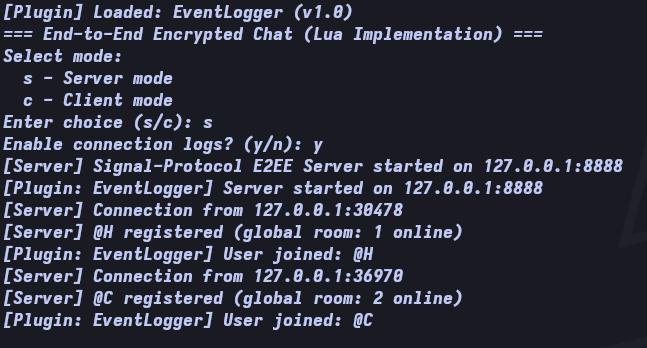
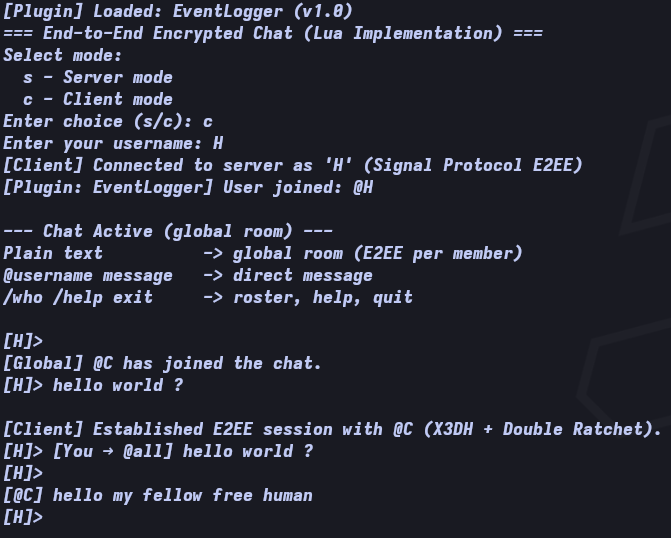
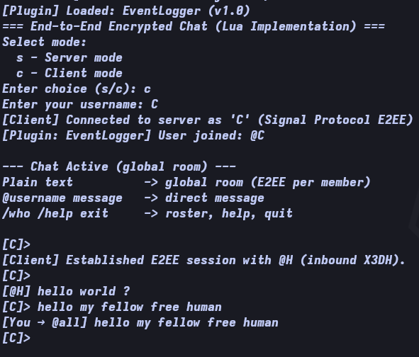

<p align="center">
  
</p>

# ratchat

> Double Ratchet + chat. End-to-end encrypted messaging in LuaJIT, over a blind relay.

An end-to-end encrypted chat system in **Lua/LuaJIT** implementing the Signal
Protocol: **X3DH** (Extended Triple Diffie-Hellman) key agreement and the
**Double Ratchet** algorithm, with a blind relaying server.

## Why

- **A readable Signal Protocol.** X3DH and the Double Ratchet are usually buried
  inside large codebases; here they are small enough to read in an afternoon,
  in an unusual language, with RFC known-answer tests backing the crypto.
- **LuaJIT + OpenSSL, directly.** All cryptography goes through LuaJIT FFI
  binding the host `libcrypto` (OpenSSL 3.x EVP API) — no bundled crypto code,
  no dependencies beyond LuaSocket and lua-cjson.
- **A minimal trusted server.** The server is a blind relay: it stores only
  public prekey bundles and routes ciphertext. It never sees plaintext or any
  private key material.

## Cryptography (real, via OpenSSL through LuaJIT FFI)

- **X25519** identity keys, signed prekeys (SPK), one-time prekeys (OPK) and ephemerals
- **Ed25519** signatures: every SPK is signed by its owner's identity; clients verify before use (MITM guard)
- **X3DH**: `SK = HKDF(DH1 || DH2 || DH3 || DH4)` with OPK consumed once per bundle fetch
- **Double Ratchet**: HKDF root-chain + HMAC-SHA256 message chains, skipped-message keys for out-of-order delivery, replay/tamper rejection via AES-256-GCM authentication
- **AES-256-GCM** for every message, with associated data binding sender/receiver identity keys and the ratchet header
- The server never sees plaintext: it only stores public prekey bundles and relays ciphertext

## Architecture

- **LuaJIT FFI** binds directly to the host `libcrypto` (OpenSSL 3.x EVP API)
- **LuaSocket** TCP networking; the server is a `socket.select()` event loop, clients multiplex stdin + socket with `poll()` (live receive while typing)
- **Plugin system** (`src/plugin.lua`): event hooks + message middleware; sample in `plugins/logger.lua`

## Development Environment (`nix-shell`)

```bash
nix-shell
```

Provides LuaJIT, LuaRocks, OpenSSL, LuaSocket and lua-cjson.

## How to Run

1. **Start the server**:
   ```bash
   luajit src/main.lua
   ```
   Select `s`. Choose `y/n` for connection logs (who connected/disconnected).

   Or non-interactively, on any host/port:
   ```bash
   luajit src/main.lua s --host 0.0.0.0 --port 9000 --logs
   ```

2. **Start clients in separate terminals**:
   ```bash
   luajit src/main.lua
   ```
   Select `c`, enter a username (1-16 letters/digits/underscores).

   Or point a client at any server instance directly:
   ```bash
   luajit src/main.lua c --host <server-host> --port 9000 --name Alice
   ```

> Run it as `luajit src/main.lua` — do not use a stale compiled `main.luac`.

## Chat Commands

| Input | Effect |
|---|---|
| `hello` | Send to the **global room** (encrypted separately per online member) |
| `@Bob hi bob` | Direct message to `@Bob` |
| `/who` | Show online users |
| `/fingerprint [@user]` | Show 60-digit safety number (yours, or a peer's) for out-of-band MITM verification |
| `/help` | Command help |
| `exit` | Quit |

Everyone gets a `[Global] @name has joined/left the chat.` notice, and the
roster is broadcast on every membership change.

## Tests

```bash
luajit src/test.lua
```

Validates RFC 4231 (HMAC) and RFC 5869 (HKDF) known-answer vectors, X25519/Ed25519/AES-GCM behaviour, X3DH agreement, and Double Ratchet roundtrips including out-of-order, replay and tamper rejection.

## Screenshots

Server relaying ciphertext between two clients:



Client `H` sending a direct message:



Client `C` receiving it:



## Known Limitations (v0.1.0)

- No offline delivery or message history: recipients must be online; joiners cannot decrypt past chatter
- No persistent identity keys: keys are regenerated per run (TOFU pinning across runs is future work)
- POSIX-only live receive (FFI `poll` on stdin); Windows clients fall back to delayed display
